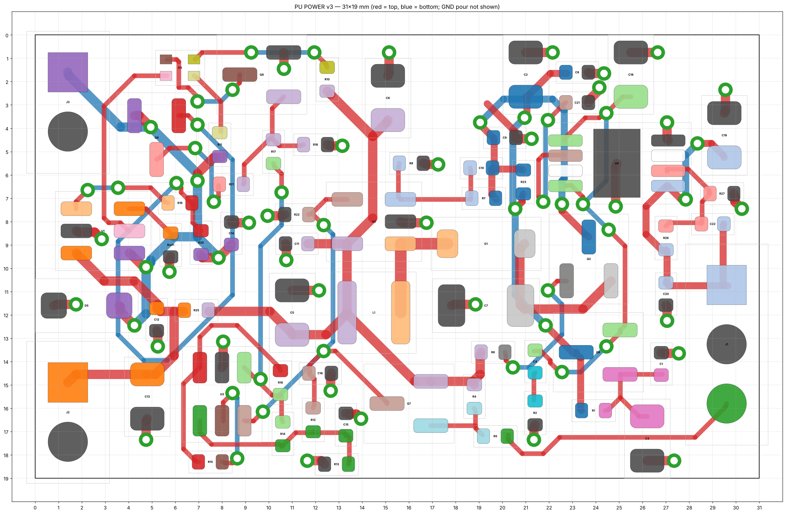
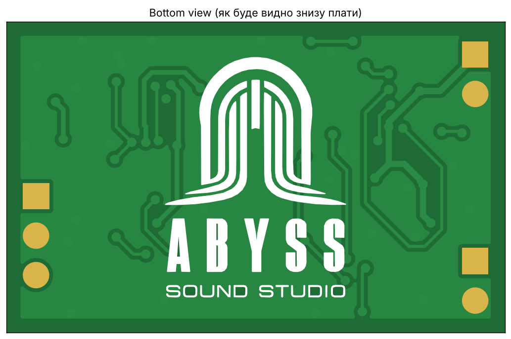

# Rechargeable Power Board for Active Guitar Pickups

Open-source, rechargeable 9 V supply for active pickups (EMG, Fishman Fluence, Seymour Duncan Blackouts and similar).
It replaces the 9 V battery: a single Li-ion/LiPo cell is charged from USB-C 5 V, boosted, heavily filtered and regulated to a clean **9.0 V**.
The board switches itself on only when a cable is plugged into the guitar (stereo jack, ring contact), and a single bi-color LED shows the charge state — the same behaviour as the Fishman rechargeable pack.

Originally based on the [freestompboxes.org thread](https://www.freestompboxes.org/viewtopic.php?t=32759); **v3** is a full redesign: smaller, lower idle current, all parts on one side, ready for turnkey assembly.

| Top (components) | Bottom |
|---|---|
|  |  |

## Specifications

| | |
|---|---|
| Board | 31 × 19 mm, 2 layers, 1.6 mm, all SMD parts on top |
| Battery | 1 × Li-ion / LiPo (18650, pouch 1200 mAh, …) **with its own protection (BMS)** |
| Charging | TP4057, 5 V from USB-C, 500 mA (Rprog = 2 kΩ) |
| Output | **9.02 V**, regulated, independent of load |
| Output noise | boost → RC (340 Hz) → capacitance multiplier (<1 Hz) → TPS7A4901 ultra-low-noise LDO (15 µV<sub>RMS</sub>, ≥52 dB PSRR to 400 kHz) |
| On/off | automatic via stereo-jack ring (ring = GND when a cable is plugged in) |
| Standby current (cable unplugged) | a few µA (charger leakage + capacitor leakage only) |
| Low-battery warning | red LED blinks below ~3.45 V (≈10–15 % left), blinking gets faster as the cell empties |

### LED indication (D3, one red/green LED)

| State | Red | Green |
|---|---|---|
| Charging | on | – |
| Fully charged | – | on |
| Playing, battery OK | – | – |
| Playing, battery low (< 3.45 V) | **blinking** | – |

## Wiring

All connections are 2.54 mm solder pads (no headers fitted). Labels are printed on the bottom silkscreen.

| Pad | Connect to |
|---|---|
| J3 `5V IN` / `GND` | USB-C charging socket in the guitar (VBUS / GND) |
| J2 `BAT+` / `GND` | battery (+ / −) — the cell **must** have its own BMS |
| J1 `+9V` | pickups / preamp +9 V (replaces the 9 V battery red wire) |
| J1 `GND` | pickups ground / output jack sleeve |
| J1 `RING` | output jack **ring** (stereo jack). Plugging a mono cable shorts ring to sleeve and turns the supply on |

> **USB-C note:** the USB-C socket in the guitar needs 5.1 kΩ pull-downs on CC1 and CC2, otherwise USB-C ↔ USB-C chargers will not supply 5 V.

## How it works

1. **Charger** – TP4057 linear charger (500 mA). STDBY drives the green LED directly (USB-powered); CHRG switches the battery-powered red LED through Q9/Q8, so the charger pins never see battery voltage when USB is unplugged.
2. **Switch-on** – Q7 is turned on by the jack ring; its collector (`VSW`) enables the boost converter and the low-battery detector. R22 holds EN low when unplugged.
3. **Boost** – TPS61041, 11.5 V (R7/R8). Q2 disconnects the output when the boost is off, so nothing drains the cell through the inductor/diode.
4. **Filtering & regulation** – R23/C2 RC filter → Q6 capacitance multiplier (R1/C3) → TPS7A4901 LDO set to 9.02 V by R26/R27 (C21 noise-reduction, C22 feed-forward).
5. **Low-battery blinker** – TLV3012 nanopower comparator with internal 1.242 V reference, wired as a relaxation oscillator that only runs below the threshold (~5 µA, only while a cable is plugged in).

## Repository layout

```
rechargeble_pack.kicad_pro / .kicad_sch / .kicad_pcb   KiCad 9 project
active_pu.kicad_sym, sym-lib-table                     project symbol library (TP4057, TLV3012, TPS7A4901, dual LED)
production/
  active-pu-charger-v3-gerbers.zip                     Gerbers + Excellon drill
  BOM-JLC.csv, CPL-JLC.csv                             JLCPCB assembly (LCSC part numbers)
  BOM-PCBWay.xlsx / .csv, CPL-PCBWay.csv               PCBWay / other turnkey assemblers (manufacturer + MPN)
docs/                                                  preview images
```

## Ordering

1. Upload `production/active-pu-charger-v3-gerbers.zip` (2 layers, 1.6 mm, any finish; min track/space 0.2/0.15 mm, min drill 0.3 mm).
2. For assembly upload the matching BOM + CPL. **Check component rotation in the assembler's placement preview** (SOT-23 and diodes are often offset by 90°/180° between KiCad and the assembler).
3. J1–J3 are wire pads — do not populate.
4. U4 (TPS7A4901) has an exposed thermal pad — it must be soldered (reflow / hot plate).

Before regenerating fabrication files after any edit: open the board in KiCad, press **B** (refill zones) and run **Inspect → Design Rules Checker**.

Notes:
- D3 (Lite-On LTST-C295KGKRKT) has no 3D model in the KiCad library, so it is not shown in the 3D viewer.
- Silkscreen reference designators are kept on the Fab layer (0402 parts are too small for the 1 mm minimum silkscreen text).

## Contacts

Designed by **[Abyss Sound Studio](https://abyss-prod.com/)** — mixing, mastering, video and photo for rock & metal musicians.

- Website: [abyss-prod.com](https://abyss-prod.com/)
- Instagram: [@abyss.sound.studio](https://www.instagram.com/abyss.sound.studio/) (best way to get in touch)
- YouTube: [@AbyssSoundStudio](https://www.youtube.com/@AbyssSoundStudio)
- Facebook: [abyss.sound.studio](https://www.facebook.com/abyss.sound.studio)
- SoundCloud: [abyss-sound-studio](https://soundcloud.com/abyss-sound-studio/sets/our-work)

Questions, bugs and improvements for this board: open an issue or pull request on GitHub.

## Contributing

Contributions are welcome — fork the repo and open a pull request.
